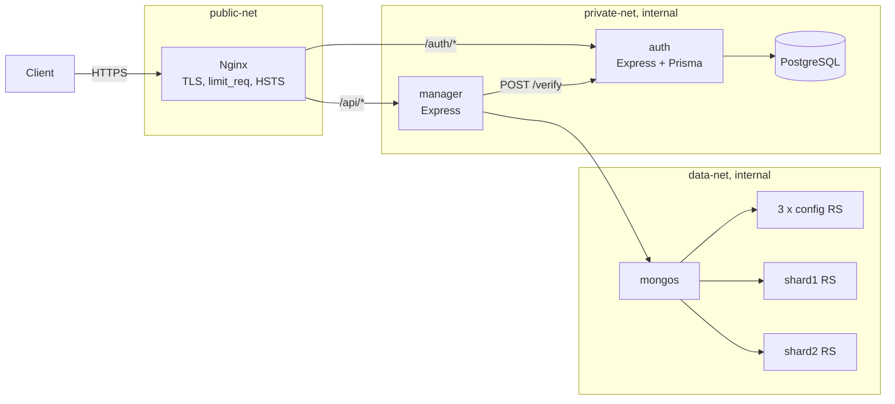

<div align="center">
  <h1>cloud-platform</h1>
  <p><b>Une plateforme de base de données à la demande, construite en microservices : un utilisateur s'authentifie, déclare un projet, réclame une instance MongoDB, et tout cela passe par une seule porte HTTPS posée devant un cluster shardé isolé du reste.</b></p>
  <p>
  
  
  
  
  
  
  </p>
  <p>
  
  
  </p>
  <p>
    <a href="#démarrer-en-cinq-minutes">Démarrer</a> ·
    <a href="#architecture">Architecture</a> ·
    <a href="#stack-technique">Stack</a> ·
    <a href="#structure-du-dépôt">Structure</a> ·
    <a href="#tests">Tests</a>
  </p>
</div>

## Ce que ça apporte

- **Trois réseaux Docker cloisonnés.** Seul Nginx touche `public-net`. `private-net` et `data-net` sont déclarés `internal: true` dans `docker/docker-compose.yml` : les services applicatifs et les données n'ont aucune sortie directe vers l'extérieur.
- **Un cluster MongoDB shardé complet, démarré par script.** Trois serveurs de configuration, deux shards de deux membres, un routeur `mongos`, initialisés par `docker/init-mongo-cluster.sh`.
- **Une authentification qui fait tourner ses jetons.** Chaque rafraîchissement supprime l'ancien refresh token et en émet un nouveau. Un refresh token expiré est effacé à sa première présentation.

## Le problème

Prenons une équipe qui veut offrir des bases MongoDB à ses utilisateurs. Elle doit savoir qui demande quoi, rattacher chaque instance à un projet et à un propriétaire, et empêcher qu'un client atteigne directement les bases. Le plus facile est d'exposer MongoDB et de se fier à la bonne volonté de chacun. Ce dépôt prend l'autre chemin : une passerelle unique, des services qui vérifient chaque jeton, et des données hors de portée du réseau public.

## Démarrer en cinq minutes

Prérequis : Docker avec Docker Compose, `openssl`, `curl`, bash.

```bash
bash scripts/generate-secrets.sh      # crée .env avec des valeurs aléatoires
bash scripts/generate-ssl-certs.sh    # certificat TLS auto-signé (développement)
bash scripts/deploy.sh start          # démarre la pile et initialise PostgreSQL et le cluster MongoDB
bash scripts/deploy.sh status         # état des conteneurs
curl -k https://localhost/auth/register -X POST -H "Content-Type: application/json" \
  -d '{"email":"user@example.com","password":"<mot_de_passe_conforme>"}'
```

Le mot de passe exige 12 caractères minimum, une majuscule, une minuscule, un chiffre et un caractère spécial. Les routes sont détaillées dans `docs/api.md` et `docs/api_admin.md`. Un compte administrateur se crée avec `ADMIN_PASSWORD='...' bash scripts/create-admin.sh`.

## Architecture



Trois choix structurent le projet.

**Le manager ne connaît pas le secret JWT.** Pour chaque requête, il envoie le jeton à `POST /verify` sur le service `auth`. Le secret de signature reste à un seul endroit, la révocation et le changement de règles se font d'un seul côté. Le prix : un appel réseau par requête, avec un délai maximal de 5 secondes.

**Deux bases, deux usages.** PostgreSQL, accessible par Prisma, porte les utilisateurs, les rôles, les projets et les refresh tokens : des données relationnelles qui demandent de la cohérence. MongoDB reçoit les métadonnées d'instances dans `userdata.instances` et sert de cible au cluster shardé.

**Un contrôle de propriété dans la couche service.** Le service `instance.service.js` compare le `user_id` de l'instance à celui du jeton avant toute lecture, mise à jour ou suppression. Les routes ne peuvent pas l'oublier : la règle vit à côté de la logique.

## Stack technique

| Domaine | Technologies | Rôle dans le projet |
|---|---|---|
| Services |  <br/>Node.js, Express 4 | Deux services HTTP : `auth` et `manager` |
| Validation | <br/>Zod | Validation des entrées des routes |
| Sécurité |   <br/>bcrypt (12 tours), jsonwebtoken, helmet, express-rate-limit, cors | Hachage des mots de passe, jetons, en-têtes, limitation de débit |
| Base relationnelle |  <br/>PostgreSQL, Prisma 5 | Utilisateurs, rôles, projets, refresh tokens |
| Base documentaire | <br/>MongoDB, cluster shardé, driver `mongodb` | Métadonnées d'instances et cluster cible |
| Passerelle | <br/>Nginx | Point d'entrée HTTPS unique |
| Conteneurs |  <br/>Docker, Docker Compose | Trois réseaux cloisonnés, déploiement de la pile |
| Journalisation | <br/>winston | Journaux des services |
| Scripts | <br/>Bash | Déploiement, secrets, TLS, sauvegarde |
| Tests |  <br/>Jest, supertest, script shell d'intégration | Tests unitaires et intégration |

## Structure du dépôt

```
.
├── src/services/
│   ├── auth/        # authentification : routes, contrôleurs, repositories Prisma, tests
│   └── manager/     # gestion d'instances : MongoDB, tests
├── docker/          # docker-compose.yml, nginx.conf, init-tables.sql, init-mongo-cluster.sh
├── scripts/         # déploiement, sauvegarde, secrets, TLS, création d'admin
├── tests/integration/api.test.sh
├── docs/            # architecture, sécurité, base de données, API, guides
├── .env.example     # variables d'environnement (valeurs factices)
└── LICENSE
```

## Tests

Pour lancer les tests unitaires :

```bash
cd src/services/auth && npm install && npx prisma generate && npm test
cd src/services/manager && npm install && npm test
```

## Limites et suite

Le périmètre est celui d'un socle d'infrastructure et d'accès, pas d'un produit fini. Chaque limite ci-dessous est un choix de départ, avec sa suite naturelle.

- **Instances logiques.** Le manager enregistre les métadonnées et génère une chaîne de connexion `mongodb://mongo-router:27017/userdata_<uuid>`. Il ne crée ni utilisateur MongoDB ni quota. Suite : un utilisateur et des droits par instance.
- **Cluster sans authentification.** MongoDB tourne sur un réseau Docker interne, protégé par l'isolation décrite plus haut. Suite : activer l'authentification interne.
- **Certificat auto-signé.** Le script cible le développement. Suite : un certificat émis par une autorité pour la production.
- **Schéma SQL appliqué par `docker/init-tables.sql`.** Les migrations Prisma ne sont pas versionnées.
- **Tests unitaires ciblés** sur les services de tokens, d'authentification, de projets et d'instances.
- **`tests/integration/api.test.sh` à remettre à jour.** Il appelle la passerelle en HTTP, lit un champ `token` alors que l'API renvoie `accessToken`, et n'envoie pas l'en-tête `Authorization` sur les routes d'instances.

## Licence

Tous droits réservés. Voir le fichier `LICENSE`.

## Contact

Jean-Paul ADOGLI, étudiant ingénieur en data science et big data. GitHub : [Jean-Paul15](https://github.com/Jean-Paul15).
