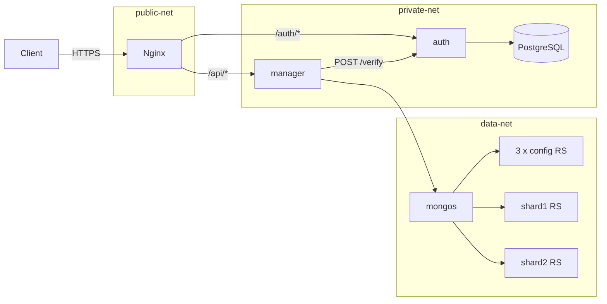

# cloud-platform

Plateforme DBaaS en microservices : authentification JWT, gestion d'instances MongoDB et infrastructure Docker (passerelle Nginx, PostgreSQL, cluster MongoDB shardé).

## Problème résolu

Fournir à des utilisateurs authentifiés un point d'entrée unique pour déclarer des projets et des instances de base de données MongoDB, au-dessus d'un cluster shardé, avec une séparation réseau entre la passerelle, les services applicatifs et les données.

## Fonctionnalités

**Service `auth`** (Express, PostgreSQL via Prisma)
- inscription, connexion, rafraîchissement et révocation de refresh tokens, vérification de jeton (`/register`, `/login`, `/refresh`, `/logout`, `/verify`) ;
- mots de passe hachés avec bcrypt (12 tours), politique de complexité validée par Zod (12 caractères minimum, majuscule, minuscule, chiffre, caractère spécial) ;
- gestion de projets par utilisateur (`/projects`) ;
- routes d'administration réservées au rôle `ADMIN` : liste et détail des utilisateurs, changement de rôle, réinitialisation de mot de passe, suppression d'utilisateurs et de projets, statistiques globales (`/admin/*`) ;
- limitation de débit sur `/register` et `/login`, en-têtes `helmet`, CORS configurable.

**Service `manager`** (Express, MongoDB)
- CRUD d'instances (`/instances`) protégé par vérification du jeton auprès du service `auth` ;
- état du cluster (`/cluster-status`) ;
- stockage des métadonnées d'instances dans la collection `userdata.instances`.

**Infrastructure** (`docker/`, `scripts/`)
- Docker Compose : passerelle Nginx, `auth`, `manager`, PostgreSQL, 3 serveurs de configuration MongoDB, 2 shards (2 membres chacun) et un routeur `mongos` ;
- trois réseaux Docker (`public-net`, `private-net`, `data-net`) ;
- Nginx : redirection HTTP vers HTTPS, TLS, `limit_req`, HSTS, routage `/auth/*` et `/api/*` ;
- scripts de déploiement, d'initialisation du cluster MongoDB, de sauvegarde, de génération de secrets et de certificat auto-signé.

## Architecture



## Stack technique

| Domaine | Technologie |
|---|---|
| Services | Node.js, Express 4 |
| Validation | Zod |
| Sécurité | bcrypt, jsonwebtoken, helmet, express-rate-limit, cors |
| Base relationnelle | PostgreSQL, Prisma 5 |
| Base documentaire | MongoDB (cluster shardé, driver `mongodb`) |
| Passerelle | Nginx |
| Conteneurs | Docker, Docker Compose |
| Journalisation | winston |
| Tests | Jest, supertest, script shell d'intégration |

## Installation

Prérequis : Docker avec Docker Compose, `openssl`, `curl`, bash.

```bash
git clone <url-du-depot>
cd cloud-platform

# 1. Secrets : génère un .env avec des valeurs aléatoires
bash scripts/generate-secrets.sh
# (alternative : cp .env.example .env puis renseigner les valeurs)

# 2. Certificat TLS auto-signé pour le développement
bash scripts/generate-ssl-certs.sh

# 3. Démarrage et initialisation (PostgreSQL, cluster MongoDB)
bash scripts/deploy.sh start
```

Le fichier `.env` et le dossier `docker/ssl/` sont ignorés par Git.

## Usage

```bash
bash scripts/deploy.sh start      # démarrer
bash scripts/deploy.sh status     # état des conteneurs
bash scripts/deploy.sh logs       # journaux
bash scripts/deploy.sh stop       # arrêter
bash scripts/backup.sh            # sauvegarde PostgreSQL et MongoDB vers ./backups
```

Appels d'API (le certificat est auto-signé, d'où `-k`) :

```bash
# Inscription puis connexion
curl -k -X POST https://localhost/auth/register \
  -H "Content-Type: application/json" \
  -d '{"email":"user@example.com","password":"<mot_de_passe_conforme>"}'

TOKEN=$(curl -k -s -X POST https://localhost/auth/login \
  -H "Content-Type: application/json" \
  -d '{"email":"user@example.com","password":"<mot_de_passe_conforme>"}' | jq -r .data.accessToken)

# Création d'une instance
curl -k -X POST https://localhost/api/instances \
  -H "Authorization: Bearer $TOKEN" -H "Content-Type: application/json" \
  -d '{"name":"ma-base","projectId":"<id_projet>"}'
```

Création d'un compte administrateur : `ADMIN_PASSWORD='...' bash scripts/create-admin.sh` (mot de passe aléatoire affiché si la variable est absente). Les routes sont détaillées dans `docs/`.

## Structure du dépôt

```
.
├── src/services/
│   ├── auth/        # service d'authentification (routes, contrôleurs, repositories Prisma, tests)
│   └── manager/     # service de gestion d'instances (MongoDB, tests)
├── docker/          # docker-compose.yml, nginx.conf, init-tables.sql, init-mongo-cluster.sh
├── scripts/         # déploiement, sauvegarde, secrets, TLS, création d'admin
├── tests/integration/api.test.sh
├── docs/            # architecture, sécurité, base de données, API, guides
├── .env.example     # variables d'environnement (valeurs factices)
└── LICENSE
```

## Tests

```bash
# Tests unitaires de chaque service
cd src/services/auth && npm install && npx prisma generate && npm test
cd src/services/manager && npm install && npm test

# Script d'intégration (pile démarrée) ; voir « Limites connues »
bash tests/integration/api.test.sh
```

## Limites connues

- Le service `manager` enregistre des métadonnées d'instance et génère une chaîne de connexion de la forme `mongodb://mongo-router:27017/userdata_<uuid>` ; il ne crée ni utilisateur MongoDB ni quota par instance.
- Le cluster MongoDB tourne sans authentification, sur un réseau Docker interne.
- Le certificat fourni par le script est auto-signé : adapté au développement uniquement.
- Les migrations Prisma ne sont pas versionnées ; le schéma est appliqué par `docker/init-tables.sql`.
- La couverture des tests unitaires est partielle (services de tokens, d'authentification, de projets et d'instances).
- `tests/integration/api.test.sh` n'est pas à jour : il appelle la passerelle en HTTP (redirigé vers HTTPS par Nginx), lit un champ `token` que l'API ne renvoie plus (`accessToken`) et n'envoie pas l'en-tête `Authorization` sur les routes d'instances. Il doit être adapté avant usage.

## Licence

Licence : tous droits réservés. Voir le fichier `LICENSE`.

## Contact

Jean-Paul ADOGLI, étudiant ingénieur en data science et big data, GitHub : [Jean-Paul15](https://github.com/Jean-Paul15).
