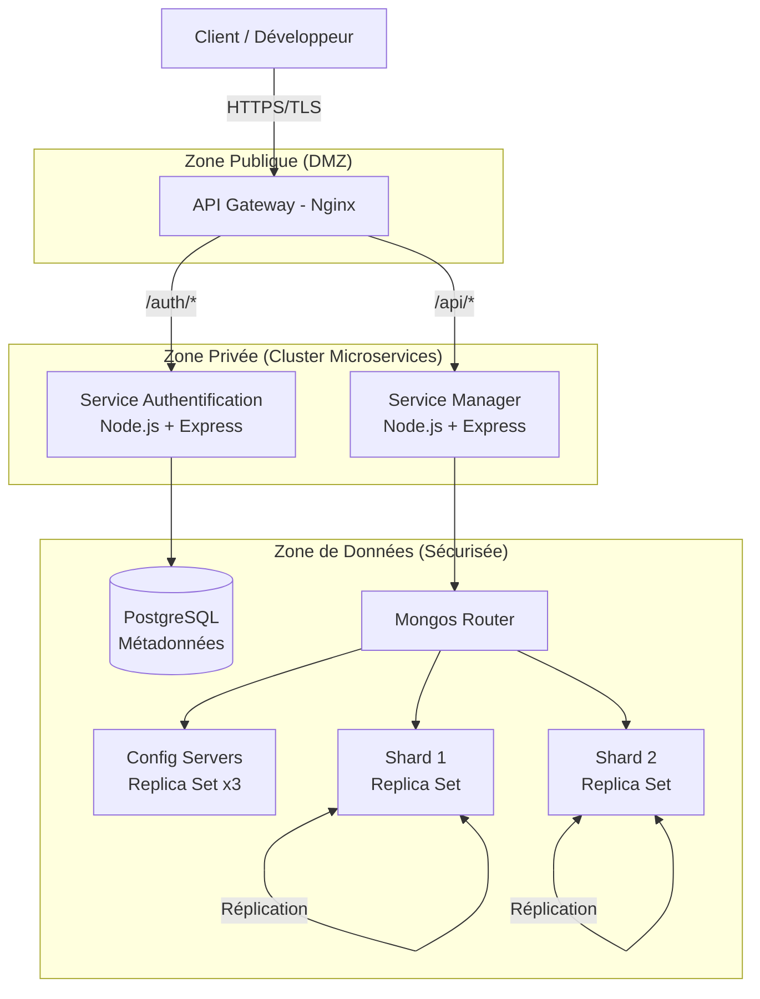

# Architecture Cloud : Projet DBaaS

## Vue d'ensemble
L'architecture repose sur une approche **Microservices** conteneurisée (Docker), favorisant la scalabilité, la résilience et la maintenance. Le système offre des bases de données à la demande (Database as a Service) avec une gestion automatisée du cycle de vie.

## Diagramme d'Architecture Logique



## Description des Composants Implémentés

### 1. API Gateway (Nginx)
*   **Rôle** : Point d'entrée unique pour toutes les requêtes externes.
*   **Technologie** : Nginx Alpine.
*   **Fonctions implémentées** :
    *   Terminaison SSL/TLS (HTTPS avec certificats auto-signés en dev)
    *   Rate Limiting (10 req/s par IP)
    *   Routage vers les microservices (`/auth/*` → Auth, `/api/*` → Manager)
    *   Headers de sécurité (HSTS, X-Frame-Options, CSP, etc.)
    *   Redirection automatique HTTP → HTTPS

### 2. Service d'Authentification (Auth Service)
*   **Technologie** : Node.js + Express + Prisma ORM
*   **Base de données** : PostgreSQL
*   **Fonctions implémentées** :
    *   Inscription (`POST /register`)
    *   Connexion (`POST /login`)
    *   Refresh Token avec rotation (`POST /refresh`)
    *   Déconnexion (`POST /logout`)
    *   Vérification de token (`POST /verify`)
    *   Gestion des projets (`GET/POST/DELETE /projects`)
*   **Sécurité** :
    *   Hachage bcrypt (12 rounds)
    *   JWT avec expiration courte (15 min)
    *   Refresh tokens stockés en base avec expiration (7 jours)
    *   Validation Zod sur toutes les entrées
    *   Rate limiting (100 req/15 min)
    *   RBAC (rôles : ADMIN, DEVELOPER, VIEWER)

### 3. Service Manager (Orchestrator)
*   **Technologie** : Node.js + Express
*   **Base de données** : MongoDB (via Mongos Router)
*   **Fonctions implémentées** :
    *   Création d'instance (`POST /instances`)
    *   Liste des instances (`GET /instances?projectId=xxx`)
    *   Détail d'une instance (`GET /instances/:id`)
    *   Mise à jour (`PATCH /instances/:id`)
    *   Suppression (`DELETE /instances/:id`)
    *   Statut du cluster (`GET /cluster-status`)
*   **Sécurité** :
    *   Authentification JWT obligatoire
    *   Vérification de propriété (user_id)
    *   Validation Zod

### 4. Cluster MongoDB (Data Layer)
*   **Config Servers** : Replica Set de 3 nœuds (stocke les métadonnées du cluster)
*   **Shards** : 2 shards, chacun en Replica Set (2 nœuds min)
*   **Mongos Router** : Point d'entrée unique pour les requêtes
*   **Clé de sharding** : `{ user_id: 1, _id: 1 }`

### 5. PostgreSQL (Métadonnées Système)
*   **Contenu** : Users, Projects, RefreshTokens
*   **Accès** : Via Prisma ORM depuis le service Auth uniquement

## Flux de Données (Workflow)

### Scénario : Création d'une Instance de Base de Données

```
1. Client → HTTPS → API Gateway
2. POST /auth/login { email, password }
3. ← { accessToken, refreshToken }

4. POST /auth/projects { name: "Mon Projet" }
   Authorization: Bearer <accessToken>
5. ← { id: "project-uuid", name: "Mon Projet" }

6. POST /api/instances { name: "ma-bdd", projectId: "project-uuid" }
   Authorization: Bearer <accessToken>
7. Manager vérifie le JWT via Auth Service
8. Manager crée l'instance dans MongoDB
9. ← { id, name, status: "RUNNING", connection_string }
```

### Scénario : Refresh du Token

```
1. Access token expiré (15 min)
2. POST /auth/refresh { refreshToken: "..." }
3. Auth Service vérifie le refresh token en base
4. Supprime l'ancien, génère un nouveau (rotation)
5. ← { accessToken: "new", refreshToken: "new" }
```

## Choix Technologiques Implémentés

| Composant | Technologie | Justification |
|-----------|-------------|---------------|
| **Backend** | Node.js + Express | Léger, asynchrone, écosystème riche |
| **ORM SQL** | Prisma | Type-safe, migrations automatiques |
| **BDD Système** | PostgreSQL 13 | ACID, relations, robuste |
| **BDD Instances** | MongoDB 5.0 Sharded | Scalabilité horizontale, flexible |
| **Gateway** | Nginx Alpine | Performant, SSL, rate limiting |
| **Conteneurisation** | Docker + Compose | Isolation, reproductibilité |
| **Validation** | Zod | Schémas typés, messages d'erreur clairs |
| **Auth** | JWT + Refresh Tokens | Stateless, sécurisé, rotation |

## Réseaux Docker (Isolation)

| Réseau | Services | Accès |
|--------|----------|-------|
| `public-net` | Gateway | Exposé (ports 80, 443) |
| `private-net` | Auth, Manager, PostgreSQL | Interne uniquement |
| `data-net` | MongoDB (tous les nœuds) | Interne uniquement |
